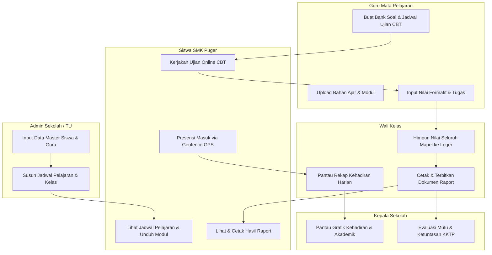

# 📋 PANDUAN LENGKAP ROLE DAN MENU SISTEM eDupu (APK LEARNING)
## SMK Puger Jember — Sistem Informasi Pembelajaran Terintegrasi

> Dokumen ini disusun berdasarkan analisis dokumen resmi **`Proposal_Sistem_APK_Learning_SMK_Puger.pdf`** yang mencakup integrasi modul: **Absensi GPS Geofence**, **Rekap Nilai Akademik**, **Ujian Digital (CBT)**, dan **Manajemen Laporan Sekolah**.

---

## 📑 Daftar Isi
1. [Ringkasan Modul Utama Sistem](#1-ringkasan-modul-utama-sistem)
2. [Struktur Role dan Tanggung Jawab](#2-struktur-role-dan-tanggung-jawab)
3. [Rincian Hak Akses & Menu per Role](#3-rincian-hak-akses--menu-per-role)
   - [A. Super Admin](#a-super-admin)
   - [B. Admin Sekolah / Tata Usaha (TU)](#b-admin-sekolah--tata-usaha-tu)
   - [C. Kepala Sekolah](#c-kepala-sekolah)
   - [D. Guru Mata Pelajaran](#d-guru-mata-pelajaran)
   - [E. Wali Kelas](#e-wali-kelas)
   - [F. Siswa](#f-siswa)
   - [G. Orang Tua / Wali Murid (Tahap Lanjutan)](#g-orang-tua--wali-murid-tahap-lanjutan)
4. [Matriks Hak Akses & Menu Antar-Role](#4-matriks-hak-akses--menu-antar-role)
5. [Daftar Kredensial Testing Cepat](#5-daftar-kredensial-testing-cepat)
6. [Alur Interaksi Antar-Role (Workflow)](#6-alur-interaksi-antar-role-workflow)

---

## 1. Ringkasan Modul Utama Sistem

Sesuai proposal, sistem eDupu (APK Learning) terbagi menjadi 5 modul operasional:

| Modul | Deskripsi Operasional |
| :--- | :--- |
| **A. Dashboard** | Ringkasan statistik jumlah siswa, guru, rombel, rekap kehadiran harian real-time, dan status aktivitas akademik sesuai hak akses. |
| **B. Absensi GPS (Geofence)** | Validasi presensi masuk/pulang siswa via browser HP berdasarkan titik koordinat resmi sekolah dan batas radius (50–100 meter). |
| **C. Pengelolaan Nilai** | Input nilai tugas/praktik (NF), ujian sumatif (NS), kalkulasi bobot otomatis (NA), serta pengelolaan KKTP kelulusan (75.0). |
| **D. Ujian Digital (CBT)** | Pembuatan bank soal (PG & esai), jadwal sesi, durasi timer mundur, autosave berkala, pengacakan soal, dan sistem anti-kecurangan (*Safe Exam*). |
| **E. Manajemen & Laporan** | Pengelolaan data master, jadwal pelajaran, cetak raport kurikulum merdeka, rekap kehadiran, dan ekspor dokumen PDF/Excel. |

---

## 2. Struktur Role dan Tanggung Jawab

Berdasarkan dokumen proposal Bab 3 (*Role dan Hak Akses Pengguna*), sistem dirancang menggunakan **6 (enam) role utama**:

| No | Role Pengguna | Tanggung Jawab Utama (Sesuai Proposal Resmi) |
| :-: | :--- | :--- |
| **1** | **Super Admin** | Mengatur konfigurasi sistem, akun, hak akses, parameter GPS, serta pengelolaan teknis dan backup. |
| **2** | **Admin Sekolah / TU** | Mengelola data siswa, guru, kelas, jurusan, mata pelajaran, jadwal, serta laporan administrasi. |
| **3** | **Kepala Sekolah** | Melihat dashboard dan laporan keseluruhan untuk monitoring serta evaluasi. |
| **4** | **Guru Mata Pelajaran** | Mengelola absensi sesuai kewenangan, menginput nilai, membuat soal, dan mengelola ujian. |
| **5** | **Wali Kelas** | Memantau kehadiran dan rekap nilai siswa pada kelas yang menjadi tanggung jawabnya. |
| **6** | **Siswa** | Melakukan absensi, melihat jadwal, mengikuti ujian, dan melihat nilai/riwayat kehadiran sesuai kebijakan sekolah. |

> **Catatan Tambahan dari Dokumen Proposal:**  
> *Orang tua dapat ditambahkan sebagai role ketujuh pada tahap lanjutan jika sekolah membutuhkan fitur pemantauan kehadiran dan nilai anak. Selain itu, guru yang juga menjadi wali kelas dapat memiliki lebih dari satu hak akses dalam satu akun.*

---

## 3. Rincian Hak Akses & Menu per Role

---

### A. Super Admin

Role dengan hak akses teknis tertinggi pada infrastruktur aplikasi eDupu.

#### 1. Yang Bisa Dilakukan:
- Mengatur konfigurasi global sistem dan kredensial aplikasi.
- Mengatur titik koordinat lintang & bujur (`latitude`, `longitude`) sekolah dan radius batas absensi (*Geofence Radius*, misal: 80 meter).
- Mengelola seluruh akun pengguna (*Create, Read, Update, Delete*) dan reset sandi massal.
- Mengatur hak akses role (*Role-Based Access Control*).
- Melakukan backup database dan restore sistem secara berkala.
- Mengaudit log aktivitas pengguna (*Audit Logs* & rekaman kecurangan CBT).

#### 2. Daftar Menu Navigasi:
1. **Dasbor Teknis (System Overview)**
   - Status server, kapasitas penyimpanan database, dan statistik pengguna aktif.
2. **Manajemen Akun & Hak Akses**
   - Sub-menu: *Akun Admin*, *Akun Guru*, *Akun Siswa*, *Hak Akses (Roles & Permissions)*.
3. **Pengaturan GPS & Geofence**
   - Peta interaktif penentuan koordinat gerbang kampus SMK Puger dan pengaturan toleransi radius (meter).
4. **Konfigurasi Sistem & CBT**
   - Pengaturan batasan sesi ujian, batas toleransi keluar layar ujian, dan sinkronisasi waktu server (WIB).
5. **Pemeliharaan & Backup**
   - Sub-menu: *Cadangan Basis Data (Backup)*, *Restore Data*, *Log Aktivitas Sistem*.

---

### B. Admin Sekolah / Tata Usaha (TU)

Role operasional harian yang mengelola seluruh administrasi akademik dan data kesiswaan SMK Puger.

#### 1. Yang Bisa Dilakukan:
- Menginput dan mengimpor data induk siswa, guru, dan staf dari Dapodik.
- Mengelola data kelas/rombel (misal: XII RPL 1, XI TKJ 2, X DKV 1) dan jurusan/program keahlian.
- Mengatur relasi mata pelajaran dengan guru pengampu.
- Menyusun master jadwal pelajaran mingguan dan jadwal ruang laboratorium/teori.
- Menerbitkan token akun siswa baru dan melayani permohonan lupa kata sandi.
- Mencetak dan mengekspor rekapitulasi data sekolah ke format Excel dan PDF.

#### 2. Daftar Menu Navigasi:
1. **Dasbor Administrasi Sekolah**
   - Ringkasan total siswa aktif, total guru, jumlah rombel per angkatan, dan kalender akademik.
2. **Data Master Kesiswaan**
   - Sub-menu: *Data Siswa Aktif*, *Alokasi Rombel/Kelas*, *Mutasi & Kelulusan*, *Sinkronisasi Dapodik*.
3. **Data Pendidik & Tenaga Kependidikan**
   - Sub-menu: *Data Guru*, *Penetapan Wali Kelas*, *Pengangkatan Guru Mapel*.
4. **Kurikulum & Akademik**
   - Sub-menu: *Program Keahlian (Jurusan)*, *Mata Pelajaran*, *Tahun Ajaran & Semester*.
5. **Jadwal Pelajaran Sekolah**
   - Matriks penyusunan jadwal pelajaran, alokasi ruang lab/teori, dan pencegahan jadwal bentrok.
6. **Pusat Bantuan & Layanan Akun**
   - Penyetelan ulang kata sandi siswa, aktivasi akun, dan bantuan administrasi.
7. **Laporan & Rekapitulasi Tata Usaha**
   - Cetak surat keterangan, rekap data siswa per jurusan, dan ekspor berkas Dapodik.

---

### C. Kepala Sekolah

Role eksekutif yang berfokus pada pengawasan, evaluasi mutu pembelajaran, dan pengambilan kebijakan.

#### 1. Yang Bisa Dilakukan:
- Memantau dasbor eksekutif tingkat kehadiran seluruh siswa dan guru setiap hari.
- Melihat grafik tren kehadiran harian, keterlambatan, dan ketidakhadiran (izin/sakit/alpha).
- Memantau ketercapaian target kurikulum dan rata-rata nilai akademik (KKTP) per jurusan.
- Melihat hasil rekapitulasi ujian CBT secara menyeluruh tanpa mengubah data.
- Mengunduh dan mencetak laporan mutu pembelajaran untuk evaluasi dinas pendidikan.

#### 2. Daftar Menu Navigasi:
1. **Dasbor Eksekutif (Monitoring Kepala Sekolah)**
   - KPI Kehadiran siswa hari ini (persentase & jumlah hadir tepat waktu).
   - Indikator rata-rata capaian nilai akademik per konsentrasi keahlian.
2. **Monitoring Presensi Seluruh Sekolah**
   - Rekap absensi harian per kelas, per jurusan, dan rekapitulasi ketidakhadiran bulanan.
3. **Monitoring Hasil Belajar & Ujian**
   - Laporan distribusi nilai Penilaian Tengah Semester (PTS) dan Akhir Semester (PAS).
   - Laporan siswa di bawah kriteria KKTP untuk program remedial.
4. **Laporan Mutu Pendidikan**
   - Cetak laporan kinerja sekolah dan evaluasi pembelajaran semesteran (PDF/Excel).

---

### D. Guru Mata Pelajaran

Role pengajar yang mengelola proses pembelajaran langsung di kelas atau laboratorium.

#### 1. Yang Bisa Dilakukan:
- Membuka absensi jam pelajaran dan memverifikasi presensi siswa di kelasnya.
- Menginput nilai tugas harian, pekerjaan lab, kuis, nilai formatif (NF), dan sumatif (NS).
- Merancang bank soal ujian CBT (Pilihan Ganda dan Esai) dengan dukungan gambar/kode program.
- Mengatur jadwal ujian, durasi menit pengerjaan, batas waktu, dan token ujian.
- Mengawasi pelaksanaan ujian CBT secara langsung (*Monitoring Real-Time Peserta Ujian*).
- Memeriksa jawaban soal esai dan memberikan koreksi nilai.
- Mengunggah modul, materi pembelajaran PDF, jobsheet lab, dan panduan tugas.

#### 2. Daftar Menu Navigasi:
1. **Dasbor Guru Pengampu**
   - Jadwal mengajar hari ini, mata pelajaran aktif, dan notifikasi tugas belum dinilai.
2. **Jadwal Mengajar Saya**
   - Daftar jadwal kelas per hari beserta ruang laboratorium/teori yang ditugaskan.
3. **Presensi Kelas / Jam Pelajaran**
   - Daftar presensi siswa per pertemuan mapel, verifikasi hadir/izin/alpha.
4. **Pengelolaan Nilai Siswa**
   - Sub-menu: *Input Nilai Formatif (Tugas/Lab)*, *Input Nilai Sumatif*, *Leger Nilai Mapel*, *Ekspor Nilai*.
5. **Ujian Digital CBT (Ruang Guru)**
   - Sub-menu: *Bank Soal*, *Buat Ujian Baru*, *Jadwal Sesi Ujian*, *Koreksi Soal Esai*, *Monitoring CBT*.
6. **Materi & Modul Digital**
   - Manajemen upload materi ajar, jobsheet praktik, dan silabus pembelajaran.

---

### E. Wali Kelas

Role guru yang memiliki tanggung jawab pembinaan khusus terhadap satu rombel/kelas siswa.

#### 1. Yang Bisa Dilakukan:
- Memantau rekap absensi kehadiran harian siswa di kelasnya (akumulasi hadir, terlambat, sakit, izin, alpha).
- Menerima surat izin/keterangan sakit dari siswa atau orang tua.
- Memantau ketercapaian seluruh mata pelajaran yang ditempuh siswa di kelasnya.
- Menyusun rekapitulasi leger nilai rapor kelas akhir semester.
- **Mencetak Dokumen Laporan Capaian Hasil Belajar Peserta Didik (Raport)** Kurikulum Merdeka lengkap dengan tanda tangan resmi.
- Menjadi narahubung utama konsultasi akademik antara sekolah dan orang tua siswa.

#### 2. Daftar Menu Navigasi:
1. **Dasbor Wali Kelas**
   - Rangkuman kelas: jumlah siswa, rekap presensi hari ini, dan peringatan siswa bermasalah absensi.
2. **Monitoring Presensi Rombel**
   - Rekap daftar hadir siswa kelas binaan per minggu dan per bulan.
3. **Leger Nilai Kelas**
   - Rekap nilai kumulatif seluruh mata pelajaran untuk penentuan peringkat dan ketuntasan KKTP.
4. **Cetak Raport Siswa**
   - Tombol cetak dan unduh dokumen raport PDF per siswa atau unduh cetak massal satu rombel.
5. **Catatan Konseling & Karakter**
   - Input catatan perkembangan sikap, kepribadian, dan prestasi ekstrakurikuler siswa di rapor.

---

### F. Siswa

Role peserta didik yang menggunakan sistem untuk kebutuhan belajar harian dan presensi.

#### 1. Yang Bisa Dilakukan:
- **Beranda Profil Siswa**: Melihat data pribadi, data akademik (NISN, rombel, wali kelas), dan ringkasan status studi.
- **Presensi GPS**: Melakukan absen masuk/pulang menggunakan geolocation GPS saat berada dalam radius kampus SMK Puger.
- **Jadwal Pelajaran**: Melihat daftar mata pelajaran harian, durasi, jam, ruang lab, dan guru pengampu (dilengkapi tombol *Cetak PDF* dan *Muat Ulang*).
- **Jadwal Ujian**: Melihat jadwal ujian PTS/PAS CBT, ruang ujian, dan tombol langsung **Mulai Kerjakan CBT** (dilengkapi tombol *Cetak Kartu Ujian PDF*).
- **Ruang Ujian Digital CBT**: Mengerjakan ujian online dengan timer mundur, penyimpanan otomatis (*autosave*), palet nomor soal, penanda ragu-ragu, dan sistem proteksi anti-kecurangan.
- **Nilai Raport**: Memantau rincian nilai formatif, sumatif, predikat, KKTP 75.0, serta tombol **Cetak / Unduh Raport PDF**.
- **Materi & Modul Digital**: Mengunduh modul belajar PDF, jobsheet lab, dan materi kisi-kisi guru.
- **Lupa Kata Sandi**: Mengajukan reset kata sandi mandiri terhubung ke nomor HP Dapodik & kontak staf TU.

#### 2. Daftar Menu Navigasi:
1. **Beranda** (Data Induk Pribadi & Akademik Siswa ala SIM Polije)
2. **Jadwal Pelajaran** (Tabel jadwal per hari + Tombol Cetak PDF + Muat Ulang + Filter Hari)
3. **Presensi GPS** (Peta Geofence Radius 80m + Tombol Presensi Masuk + Riwayat Mingguan)
4. **Jadwal Ujian** (Daftar ujian UTS/UAS + Tombol Mulai Kerjakan CBT + Tombol Cetak Kartu PDF)
5. **Nilai Raport** (Tabel capaian kompetensi + Tombol Cetak Raport PDF + Filter Semester)
6. **Materi Modul** (Katalog bahan ajar & unduh dokumen PDF)

---

## 4. Matriks Hak Akses & Menu Antar-Role (6 Role Resmi)

Keterangan:
- **CRUD**: *Create, Read, Update, Delete* (Akses Penuh Pengelolaan)
- **R / View**: *Read Only* (Melihat dan Memantau)
- **Exec**: Menjalankan / Mengikuti aksi (misal: pengerjaan ujian / presensi)
- **-**: Tidak memiliki akses

| Fitur / Menu Sistem | Super Admin | Admin TU | Kepala Sekolah | Guru Mapel | Wali Kelas | Siswa |
| :--- | :---: | :---: | :---: | :---: | :---: | :---: |
| **Dasbor Utama** | Sistem | Akademik | Eksekutif | Pengajar | Kelas | Mandiri |
| **Konfigurasi Server & GPS** | CRUD | - | - | - | - | - |
| **Data Master (Siswa/Guru/Kelas)** | CRUD | CRUD | R | R | R | - |
| **Jadwal Pelajaran** | CRUD | CRUD | R | R (Tugas) | R (Kelas) | R + Cetak |
| **Presensi GPS Geofence** | Setting | R / Rekap | Monitoring | Verifikasi | Rekap Rombel | **Exec (Absen)** |
| **Pengelolaan Bank Soal CBT** | R | - | - | **CRUD** | - | - |
| **Pelaksanaan Ujian CBT** | Monitor | - | R | Monitor | - | **Exec (Kerjakan)** |
| **Input Nilai (Formatif/Sumatif)** | - | - | - | **CRUD** | - | - |
| **Leger Nilai Rombel** | R | R | R | R (Mapel) | **CRUD** | - |
| **Cetak Lembar Raport Siswa** | - | R | R | - | **Cetak Resmi** | **Unduh PDF** |
| **Modul & Bahan Ajar Digital** | R | - | - | **Upload** | R | **Unduh PDF** |
| **Reset / Layanan Kata Sandi** | Full | Eksekusi | - | - | - | Pengajuan |

---

## 5. Daftar Kredensial Testing Cepat (6 Role)

Daftar akun pengujian siap pakai (tersedia juga di [docs/KREDENSIAL_LOGIN_TESTING.md](KREDENSIAL_LOGIN_TESTING.md)):

| Role | Nama Akun | Username / NISN / NIP | Password | Halaman Tujuan |
| :--- | :--- | :--- | :--- | :--- |
| **1. Siswa** | Bagus Permadi | `0058291042` *atau* `bagus` | **`siswa123`** | `dashboard.html` |
| **2. Guru Mapel** | Bpk. Rian Hidayat, S.T. | `19880415` *atau* `guru` | **`guru123`** | `instructor-dashboard.html` |
| **3. Wali Kelas** | Bpk. Hendro, S.Kom. | `19840212` *atau* `wali` | **`wali123`** | `instructor-dashboard.html` |
| **4. Admin TU** | Ibu Siti Rahayu, S.Pd. | `admintu` *atau* `admin` | **`admin123`** | `instructor-dashboard.html` |
| **5. Kepsek** | Drs. H. Bambang Sutrisno | `kepsek` *atau* `19671108` | **`kepsek123`** | `instructor-dashboard.html` |
| **6. Super Admin** | Tim IT Administrator | `superadmin` | **`superadmin123`** | `instructor-dashboard.html` |

---

## 6. Alur Interaksi Antar-Role (Workflow)

---
*Dokumen ini diperbarui secara resmi untuk menyelaraskan arsitektur perangkat lunak eDupu (APK Learning SMK Puger).*

